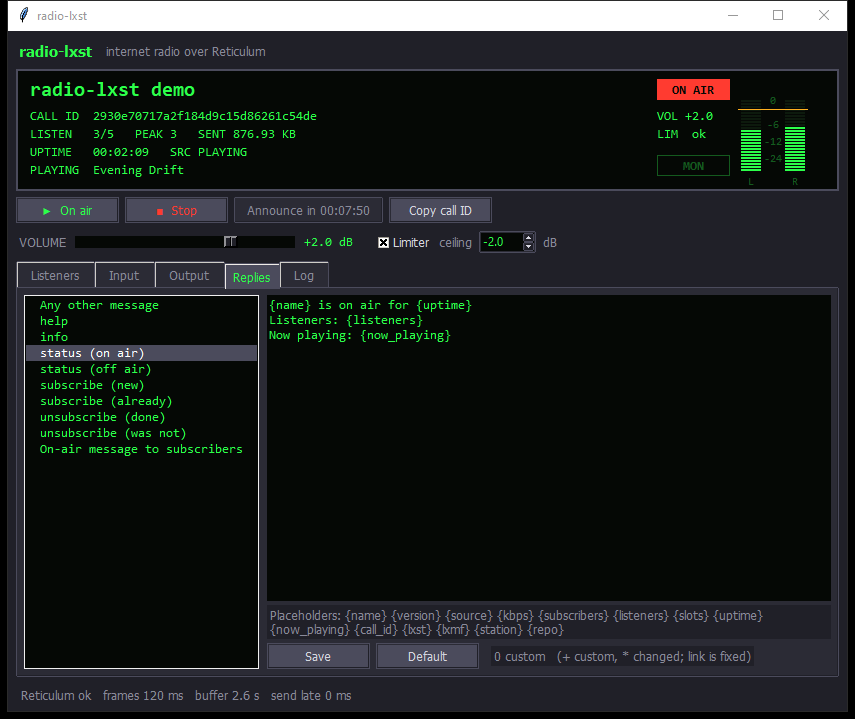
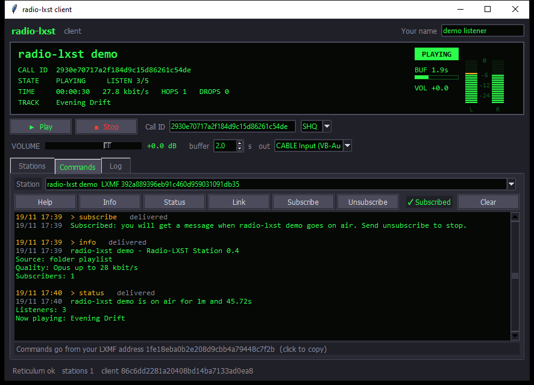

# radio-lxst

Internet radio over [Reticulum](https://reticulum.network). Put a web radio stream, a folder of music or a live sound card input on the air, and listeners tune in by **calling** the station, like a phone call, with [LXST](https://pypi.org/project/lxst/): from the radio-lxst client, Sideband or rnphone.

Version 0.4 · [Reticulum License](LICENSE)

| Server | Client |
|---|---|
|  |  |
|  |  |

## What it does

- **Server**: plays an existing stream (Icecast, Shoutcast, Zeno, any http audio) a folder (shuffle, next track) or a live input (mic, line in, VB-Cable, an SDR app, Loopback of what the PC plays), with volume and limiter. Many listeners at once, each on its own encrypted Reticulum Link (each one costs ~28 kbit/s of upload: set listener slots to cap it; when full, new callers get "busy"). Announces itself so clients can find it.
- **Client**: list of the stations heard on the network, a steady 3 s buffer, volume, output device, and the station's name, listeners and track during the call.
- **Compatible**: any LXST phone (Sideband, rnphone) can listen too, it just calls the station's Call ID.

## Quickstart

You need Python 3.10+ and a working Reticulum setup (if `rnsd` is running the programs use it, otherwise they start Reticulum with your `~/.reticulum` config). The server also needs [ffmpeg](https://ffmpeg.org).

### Windows

```
pip install -r requirements.txt
winget install Gyan.FFmpeg
```

- Server: double click `radio-gui.bat`, choose the source in **Input**, press **On air**, copy the **Call ID**.
- Client: double click `client-gui.bat`, paste the Call ID (or double click a station in the list), press **Play**.

### Linux (Debian/Ubuntu)

```
sudo apt install python3-pip python3-tk ffmpeg
pip install -r requirements.txt --break-system-packages
python3 radio_gui.py           # server
python3 radio_client_gui.py    # client
```

The client plays through PulseAudio or PipeWire. If `pip` fails on `pycodec2` (pulled in by `lxst`, not used here): `sudo apt install libcodec2-dev` and retry.

## Terminal

Server (also fine on a headless box):

```
python radio_lxst.py --url https://example.com/live.mp3 --name "My Radio"
python radio_lxst.py --folder ~/music --shuffle --name "My Radio"
python radio_lxst.py --list-inputs
python radio_lxst.py --input "CABLE Output" --name "My Radio"
```

Options: `--slots N` (max listeners at once, 0 = no limit), `--announce-every MIN`, `--no-lxmf`, `--lxmf-every HOURS`, `--gain DB`, `--ceiling DBFS`, `--no-limiter`, `--frame-ms 60|120`, `--identity FILE`, `--rnsconfig DIR`.

Client:

```
python radio_client.py <Call ID>
python radio_client.py --list 60      # wait 60 s for station announces
python radio_client.py <Call ID> --cmd status   # send a command, print the reply
```

Options: `--quality SHQ|HQ|MQ|LBW|VLBW|ULBW`, `--buffer SEC`, `--volume DB`, `--device NAME`, `--nick NAME`.

On Linux use `python3`.

## Using the GUIs

Server:
- **Input**: stream URL, folder or line input (pick the device from the list, **Refresh** after plugging one in). **Switch now** changes source on air, listeners stay connected.
- **Output**: station name, quality, announce on air and every N minutes (20 at least), go on air at start. One announce every 10 minutes at most, Announce now included: one asked sooner waits for the 10 minutes and goes out if the station is still on air. Stop sends no announce. **LXMF**: autoresponder and subscriber messages on or off, LXMF address announced every N hours (1 at least, default 3).
- **Replies**: edit what the station answers to each command (help, info, status, subscribe, unsubscribe, any other message, the on-air message). Placeholders like `{name}`, `{listeners}`, `{now_playing}` are filled when sent. Empty or **Default** = the built-in text. `link` is fixed: it always sends the addresses and the link to this repo. Saved in `storage/replies.json`, used by the terminal server too.
- **Listeners**: who is tuned in (with the name from their LXMF announce, when known, and a ✓ in Sub if subscribed), quality, time, kbit/s.
- Volume and limiter work live; the display shows how much the limiter pulls down.
- **MON** on the display: hear what goes on air on this PC (choose the device in Output > Monitor).
- Meters have a dB scale; the amber line is the limiter ceiling.

Client:
- Double click a station to listen. **Refresh** asks the stations for their state now. "Play last station at start" resumes on launch.
- Buffer: more seconds = fewer dropouts on slow paths.
- Your name: sent to the station inside the call, shown in its listener list. Empty = `Radio-LXST Client #xxxx` (start of your identity hash).
- **Commands**: pick a station and press help, info, status, link, subscribe or unsubscribe; the replies show below. They go over LXMF from the client identity (its address is at the bottom, click to copy) to the station's LXMF address, shown in the list. On-air messages reach the client while it is open: they show in the status bar and the Log for a while, and in Commands. The tab and the Sub column of Stations show if you are subscribed. The first start makes the announce stamp of the client's LXMF address in the background (STAMP on the display, a few minutes, once): the command buttons are grey until then.
- If the first path is stale the client drops it and asks for a fresh one, then gives up. If the station is lost while playing (no audio for 20 s) it redials after 15, 30, 60 and 120 s; a station that stops on purpose is not redialed.

Line input, for example from an SDR program:
- Send the SDR audio to **CABLE Input** (VB-Audio Virtual Cable) and choose **CABLE Output**, or
- leave it on the speakers and choose **Loopback: <your speakers>**: everything the PC plays goes on air.
- On Linux the PulseAudio/PipeWire monitor sources work as loopback.

Addresses are copied with a click: the CALL ID line on the display, the addresses in Output, right click on a station or a listener.

## Listening with Sideband or rnphone

- **Sideband**: Voice, enter the Call ID, call. Use profile **SHQ** and **half duplex**. To see the station name instead of an anonymous caller, save its LXMF address as a contact.
- **rnphone** (`pip install lxst`): type the Call ID and press Enter; Enter again hangs up.

## Messaging the station

With LXMF on, the station answers messages sent to its LXMF address:

- `help`, `info`, `status` (on air, listeners, now playing), `link` (Call ID, all the station addresses, link to this repo)
- `subscribe`: a message each time the station goes on air, with the track or "Live Stream"
- `unsubscribe`
- anything else: a hello with the list of commands

The client sends them from its **Commands** tab, rBrowser from the Commands pane of its Radio tab.

At most 20 answers per sender per minute, one on-air message every 30 min at most. Messages, subscriptions and deliveries show up in the station log. Subscribers are kept in `storage/subscribers.json`.

## How it works

- The station announces up to three destinations from one identity, 5 s apart: `lxst.telephony` (the number to call), `radiolxst.station` (only name, version and quality: it says the station exists) and, with LXMF on, `lxmf.delivery` (its name in Sideband, messages) every few hours only.
- ffmpeg decodes stream and files, the sound card input is read directly; radio-lxst encodes Opus once per quality in use and sends the same frames to every listener on that quality.
- The quality follows the caller's profile: Opus stereo 48 kHz for HQ/SHQ, stereo 24 kHz for MQ, mono for the low bandwidth profiles.
- Announces never carry what changes. The clients ask each station for its state (on air, listeners, track or "Live streaming", slots) with a `status` request over a Link: every 3 min per station heard in the last day, 3 at a time, and with **Refresh**; the station playing tells it inside the call instead. A station that does not answer shows "no reply". The station answers 120 status requests a minute at most. Stations before 0.4 still put their state in the announce and are read from there.
- With RNS 1.6.1 or newer every announce carries a stamp. On the first start of a new station they take a few minutes (the display shows STAMPS n/2 or n/3), the station goes on air by itself when they are ready; later starts reuse them from disk.
- **Steady** (default): 120 ms packets, about 28 kbit/s per listener. **High**: 60 ms packets, up to 56 kbit/s. Meant for internet links (TCP, I2P), not LoRa.
- During the call the station also sends name, listeners and track in a msgpack key (`"radiolxst"`). LXST only reads the signalling and audio keys, so other phones ignore it.
- The caller's microphone is ignored.

## Changes

- 0.4: Added LXMF autoresponder.
- 0.4: Added subscribe for on-air messages.
- 0.4: Listener names in the list.
- 0.4: Announces 5 s apart.
- 0.4: LXMF announce every 3 h.
- 0.4: Added listener slots.
- 0.4: Stopped stations shown offline.
- 0.4: Ignore replayed station announces.
- 0.4: Client sends its name in the call.
- 0.4: 20 LXMF replies per minute.
- 0.4: Added client Commands tab.
- 0.4: Added custom station replies.
- 0.4: link sends all addresses and repo.
- 0.4: Client shows subscriptions.
- 0.4: Held announces sent after the gap.
- 0.4: Station state by request, not in announces.

- 0.3: Added MON local monitor.
- 0.3: Added dB scale and ceiling line on meters.
- 0.3: Added stamp preparation before going on air.
- 0.3: Announce every 60 min by default.
- 0.3: Announce limits: periodic 20 min min, any 10 min min.
- 0.3: Client buffer 3 s by default.
- 0.3: Client retries a stale path.
- 0.3: Client redials after a drop.
- 0.3: Fixed audio crashes on Windows.
- 0.3: Fixed crash when switching stations.
- 0.3: "Live streaming" for streams and line input.
- 0.3: Client log file in storage.
- 0.2: Added line input source (mic, sound card, VB-Cable, loopback).
- 0.1: First release.

## Files

`radio_lxst.py` server engine and CLI, `station_lxmf.py` station messages, `radio_gui.py` server window, `radio_client.py` client engine and CLI, `client_lxmf.py` client commands, `radio_client_gui.py` client window, `ui_common.py` shared look.

Settings are saved next to the scripts (`settings.json`, `client_settings.json`), identities and the station list in `storage/`. The client GUI also writes `storage/client.log` (and `client_crash.log` if it ever crashes). Run one server per identity.

## Responsible use

Whoever runs a station is solely responsible for what it broadcasts and must hold the rights to it. The author strongly discourages music piracy: broadcast only your own works, free-licensed music, or content you are allowed to share.

## License

Released under the **Reticulum License**, the same license as [Reticulum](https://github.com/markqvist/Reticulum): free to use, modify and share, but not in systems meant to harm people and not for AI/ML training datasets or models. Full text in [LICENSE](LICENSE).
