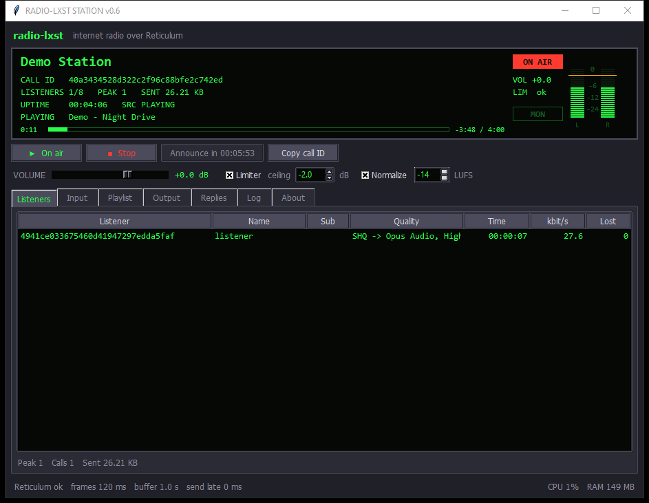
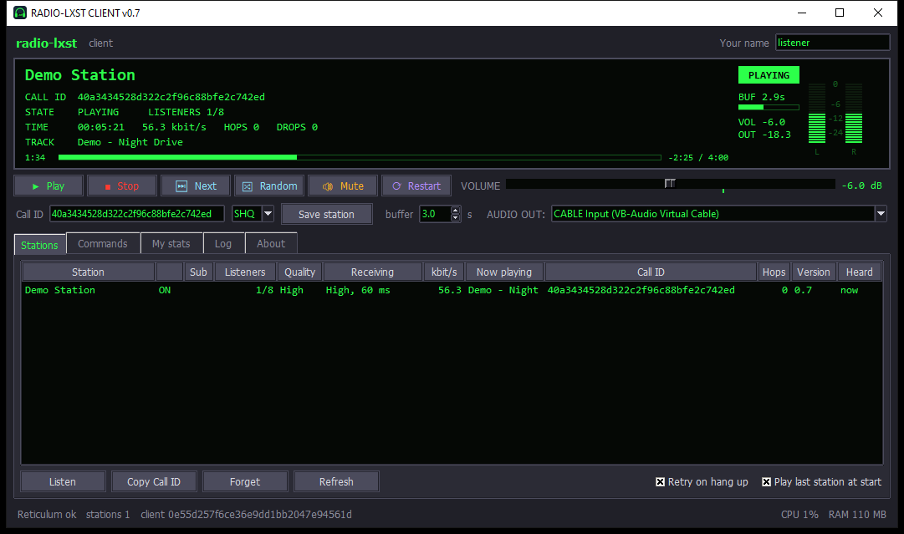
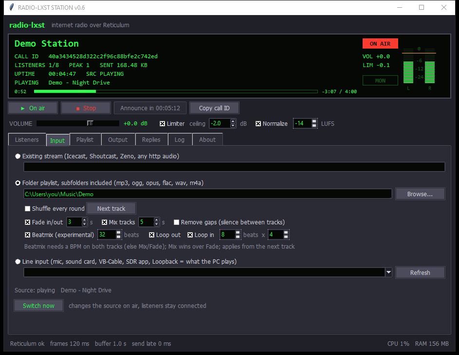
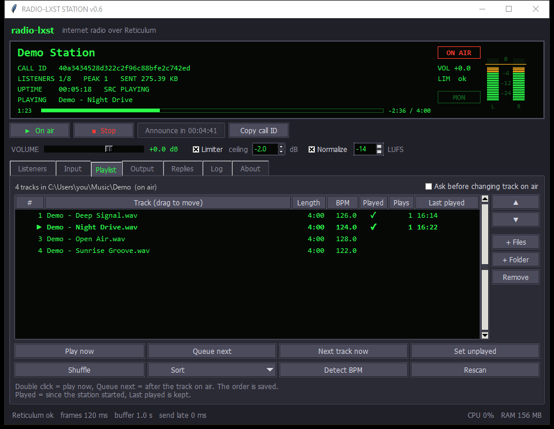

# radio-lxst

Internet radio over [Reticulum](https://reticulum.network). Put a web radio stream, a folder of music or a live sound card input on the air, and listeners tune in by **calling** the station, like a phone call, with [LXST](https://pypi.org/project/lxst/): from the radio-lxst client, Sideband, Columba or rnphone.

Version 0.7 · [Reticulum License](LICENSE)

| Server | Client |
|---|---|
|  |  |
|  |  |

## What it does

- **Server**: plays an existing stream (Icecast, Shoutcast, Zeno, any http audio) a folder with its subfolders (shuffle, next track, fade, crossfade, beatmix, gap removal) or a live input (mic, line in, VB-Cable, an SDR app, Loopback of what the PC plays), with volume and limiter. Many listeners at once, each on its own encrypted Reticulum Link (each one costs ~28 kbit/s of upload: set listener slots to cap it; when full, new callers get "busy"). Announces itself so clients can find it.
- **Client**: list of the stations heard on the network, a steady 3 s buffer, volume, output device, and the station's name, listeners and track during the call.
- **Compatible**: any LXST phone (Sideband, rnphone) can listen too, it just calls the station's Call ID.

## Quickstart

You need Python 3.10+ and a working Reticulum setup (if `rnsd` is running the programs use it, otherwise they start Reticulum with your `~/.reticulum` config). The server also needs [ffmpeg](https://ffmpeg.org).

### Windows

```
pip install -r requirements.txt
winget install Gyan.FFmpeg
```

- Server: double click `radio-gui.bat`, choose the source in **Input**, press **On air**, copy the **Call ID**.
- Client: double click `client-gui.bat`, paste the Call ID (or double click a station in the list), press **Play**.

### Linux (Debian/Ubuntu)

```
sudo apt install python3-pip python3-tk
sudo apt install --no-install-recommends ffmpeg
pip install -r requirements.txt --break-system-packages
python3 radio_gui.py           # server
python3 radio_client_gui.py    # client
```

The client plays through PulseAudio or PipeWire. If `pip` fails on `pycodec2` (pulled in by `lxst`, not used here): `sudo apt install libcodec2-dev` and retry.

## Terminal

Server (also fine on a headless box):

```
python radio_lxst.py --url https://example.com/live.mp3 --name "My Radio"
python radio_lxst.py --folder ~/music --shuffle --mix 5 --trim-silence --name "My Radio"
python radio_lxst.py --list-inputs
python radio_lxst.py --input "CABLE Output" --name "My Radio"
python radio_lxst.py --settings settings.json   # same setup as the GUI
```

Folder options: `--fade SEC` (fade in/out of each track), `--mix SEC` (crossfade, wins over fade between tracks), `--trim-silence` (cut the silence at start and end of tracks, and gaps longer than 20 s inside them), `--beatmix BEATS` (mix on the beat, see Beatmix below), `--loop-out`, `--loop-in`, `--loop BEATS`, `--loop-times N` (Beatmix loops), `--normalize LUFS` (same loudness for every track, -18 to -8).

Options: `--slots N` (max listeners at once, 0 = no limit), `--announce-every MIN`, `--no-lxmf`, `--lxmf-every HOURS`, `--gain DB`, `--ceiling DBFS`, `--no-limiter`, `--phone-any`, `--frame-ms 60|120`, `--identity FILE`, `--rnsconfig DIR`.

Same setup as the GUI: `python radio_lxst.py --settings settings.json` (options given on the line win). Relative paths in the file are taken from its folder. More stations at once: one settings file each, with its own `identity` (own Call ID and storage), started with `python radio_gui.py other.json` or `--settings other.json`. A second station on the same identity folder does not start.

Control a running terminal station from another terminal on the same machine (everything the GUI does: on air, stop, announce, source, next, seek, playlist, folder options, volume, output, replies, log):

```
python radio_lxst.py --settings settings.json --ctl            # prompt, help lists the commands
python radio_lxst.py --settings settings.json --ctl next       # one command
python radio_lxst.py --settings settings.json --ctl play 12
python radio_lxst.py --settings settings.json --stats          # statistics (also with the GUI station)
nc -U storage/ctl.sock                                         # Linux: same text commands with netcat
```

Use the same `--settings` (or `--identity`) as the station. Changes are saved in its settings file. The channel is local only: a Unix socket in the identity folder (owner only) on Linux and Mac, 127.0.0.1 with a token in `ctl.json` on Windows (send `auth TOKEN` first). The station prints all its addresses at start, `id` shows them again. Started with no source, it waits off air for one (`source folder PATH`, then `onair`).

Playlist at the `--ctl` prompt (paths with spaces in quotes):

```
list                          # numbered tracks, > = on air
add "/music/new album"        # a folder or a file from anywhere, the files stay where they are
add /music/one.mp3
remove 3-7                    # out of the list, files stay on disk
clear yes                     # empty the list, the track on air plays to its end
add /music                    # the playlist folder again: its tracks come back
added / unadd N               # files and folders added, forget one
```

An empty list on air stays silent; a track added plays within 10 s.

Client:

```
python radio_client.py <Call ID>
python radio_client.py --list 60      # wait 60 s for station announces
python radio_client.py <Call ID> --cmd status   # send a command, print the reply
```

Options: `--quality SHQ|HQ|MQ|LBW|VLBW|ULBW`, `--buffer SEC`, `--volume DB`, `--device NAME`, `--nick NAME`.

On Linux use `python3`.

## Using the GUIs

Server:
- **Input**: stream URL, folder or line input (pick the device from the list, **Refresh** after plugging one in). The folder is read with all its subfolders. **Fade in/out** (default 3 s), **Mix tracks** (crossfade, default 5 s, wins over fade between tracks) and **Remove gaps** change from the next track, also on air. **Beatmix** (experimental, not always in time: fine for fun, not for a real live show; 8 to 128 beats, default 32) tries to mix like a DJ when both tracks have a BPM: the next track starts on a bar of the one playing, stretched to its tempo (pitch kept, at most 8%), so the beats fall together: it comes up over the first half of the mix, the old one goes down over the second half; after the mix the new one slides back to its own tempo. Before each mix the start of the new track is test-rendered and its kicks lined up with the old one. **Loop out** repeats 4, 8 or 16 beats of the old track from the mix point, **Loop in** the first beats of the new one, 4, 8 or 16 times; then the new track goes on. **Next track** and **Play now** also beatmix, on the first bar 2 s or more ahead. Turned on while on air, it works from the end of the next track. While two tracks are mixed (Beatmix or Mix) the station progress bar blinks amber and both tracks turn amber in the Playlist. With Beatmix on, the Log gets one line per change of track (tempos, stretch, beats found, or why it fell back to Mix/Fade) and, after the mix, how far apart the kicks of the two tracks were heard; the same lines go to `storage/beatmix.jsonl`. Tracks without a BPM, or too far apart, get Mix or Fade. With Beatmix on, Remove gaps cuts only the start and the end of tracks with a BPM. With a folder the display shows a progress bar of the track (elapsed, time left and length, from ffprobe), the client shows it too, in time with what it plays. Click the station bar to jump in the track (not during a mix); a click at the very end lands just before the mix, to try mixes without waiting. With a stream or line input the box shows a scrolling text instead: `HTTP STREAM: name` (the stream icy-name, or the URL) or `LINE INPUT: device` on the station, `LIVE STREAMING: name` on the client (the stream name only, never the URL or the device). If the stream sends the track title (StreamTitle, read every 20 s) it is added: `Live streaming - title`, also in the client track line, status replies and on-air messages; otherwise plain `Live streaming`. **Switch now** changes source on air, listeners stay connected: the old source keeps playing while the new one connects (no gap), then they crossfade (Mix seconds, else Fade, else a quick cut).
- **Playlist**: the tracks of the folder set in Input (subfolders included), the one on air marked ▶. Drag a track or use ▲ ▼ beside the list to move it, **Queue next** puts it after the one on air, **Play now** (or double click) fades to it (if the station is off it asks, then goes on air; does nothing while a stream or line input is on air; with **Ask before changing track on air** it asks first, also for **Next track now**), **Next track now** skips to the next one, **Shuffle** and **Sort** (drop-down: title, BPM, length, plays, not played yet, last played, random) reorder the list once, **Rescan** reads the folder again (and the added ones). **+ Files** and **+ Folder** add tracks from anywhere: they stay where they are, only the playlist keeps them; **Remove** takes the selected tracks out of the list, the files on disk are not touched (a track of the folder comes back if you add it again with **+ Files**); **Clear** empties the list (asks first, files stay on disk), **+ Folder** on the playlist folder brings it back. **Played** marks the tracks aired since the station started (**Set unplayed** clears the mark), **Plays** and **Last played** are kept in `storage/played.json`, **Length** in `storage/bpm.json`. **BPM** is measured in the background, one track at a time (numpy only, cached in `storage/bpm.json`); **Detect BPM** measures the selected tracks again. Changes work on air. Your order is saved in `storage/playlist.json` and used at every On air (also by the terminal server): new files go to the end, removed ones drop out. **Shuffle every round** in Input mixes the list again each time it starts over.
- **Output**: station name, quality, announce on air and every N minutes (20 at least), go on air at start. One announce every 10 minutes at most, Announce now included: one asked sooner waits for the 10 minutes and goes out if the station is still on air. Stop asks for confirmation, then sends no announce. **LXMF**: autoresponder and subscriber messages on or off, LXMF address announced every N hours (1 at least, default 3).
- **Replies**: edit what the station answers to each command (help, info, status, subscribe, unsubscribe, any other message, the on-air message). Placeholders like `{name}`, `{listeners}`, `{now_playing}` are filled when sent. Empty or **Default** = the built-in text. `link` is fixed: it always sends the addresses and the link to this repo. Saved in `storage/replies.json`, used by the terminal server too.
- **Stats**: this run and all time: running and on-air time, listens, different listeners, peak, listening time, radio-lxst clients and phones, tracks played, data sent, subscribes, messages, plus the most played tracks. Saved every minute in `storage/stats.json`, counts only (listeners are told apart by a salted hash, no names). The same table with `--stats` or `stats` at the `--ctl` prompt; with the GUI station running `--stats` shows the all-time totals of the last save.
- **Listeners**: who is tuned in (with the name from their LXMF announce, when known, and a ✓ in Sub if subscribed), quality, time, kbit/s.
- Volume and limiter work live; the display shows how much the limiter pulls down.
- **Normalize** (folder only): every track is brought to the same loudness, -18 to -8 LUFS (-14 like streaming services, -8 for a hotter master). The loudness of each track is measured in the background with the BPM; it changes from the next track. Quiet tracks are raised at most 12 dB, the limiter holds the peaks, so near -8 the result can stay a little under the target. OUT on the station display shows the level going on air (3 s average, close to LUFS) to check it. The Gain dB column of the playlist shows what each track gets; Volume is added after, so -11 with Volume -1.5 lands near -12.5.
- **MON** on the display: hear what goes on air on this PC (choose the device in Output > Monitor).
- Meters have a dB scale; the amber line is the limiter ceiling.

Client:
- Double click a station to listen. Click the ☆ at the start of a row (or right click > Add to favourites) to star a station: favourites stay at the top of the list. **Refresh** asks the stations for their state now. **Quality** is what the station streams (High = 60 ms packets, Steady = 120 ms); on the station you listen to, **Receiving** shows what you get (Opus profile, packet length) and **kbit/s** the rate, like the station Listeners tab. "Play last station at start" resumes on launch. **Next** and **Random** switch to another station on air (Next goes by name, never the one playing). **Mute** silences the audio and keeps the station connected. **Restart** closes the client and opens it again the same way it was started. Double click the volume slider for 0 dB (the mark under it). **Save station** puts the Call ID typed in the list without listening (a station seen on a map whose announce never reached you): its name and state are asked at once. **My stats** (today and all time, in `storage/my_stats.json`, never track titles): listening time, listens, longest listen, tracks heard (a count), stations listened and seen, audio dropouts, and the stations you listen to most. "Retry on hang up" (on by default, `--reconnect` in the terminal client) tries 3 times when the station closes the call (at once if it announces again), then shows it offline.
- Buffer: more seconds = fewer dropouts on slow paths. **DROPS** counts the times the buffer ran empty (network); **CARD** the times the sound card ran dry with audio still in the buffer (PC too busy).
- Your name: sent to the station inside the call, shown in its listener list. Empty = `Radio-LXST Client #xxxx` (start of your identity hash).
- **Commands**: pick a station and press help, info, status, link, subscribe or unsubscribe; the replies show below. They go over LXMF from the client identity (its address is at the bottom, click to copy) to the station's LXMF address, shown in the list. On-air messages reach the client while it is open: they show in the status bar and the Log for a while, and in Commands. The tab and the Sub column of Stations show if you are subscribed. **Clear** empties only the replies shown, the subscription stays (`storage/subscriptions.json`). The first start makes the announce stamp of the client's LXMF address in the background (STAMP on the display, a few minutes, once): the command buttons are grey until then. **Announce** (next to the address) sends the client's LXMF announce, so stations learn its key: once every 10 minutes at most.
- If the first path is stale the client drops it and asks for a fresh one, then gives up. If the station is lost while playing (no audio for 20 s) it redials after 15, 30, 60 and 120 s; a station that stops on purpose is not redialed.

Line input, for example from an SDR program:
- Send the SDR audio to **CABLE Input** (VB-Audio Virtual Cable) and choose **CABLE Output**, or
- leave it on the speakers and choose **Loopback: <your speakers>**: everything the PC plays goes on air.
- On Linux the PulseAudio/PipeWire monitor sources work as loopback.

Both windows check GitHub at start and every 12 hours: when a newer version is out, a bar above the status line says so, click it to open the repo. Nothing is installed by itself. The version is in the window title, and the About tab shows it with the repo link and a fresh update check. If the shared Reticulum instance (rnsd or the app running it) goes away, a red bar says so (green for 5 s when it is back) and the station badge blinks WAITING; the station stays on air and is back on the network as soon as the instance returns. Loss and return are written in the log, terminal versions too. The terminal server and client write the same notice in their log.

Addresses are copied with a click: the CALL ID line on the display, the addresses in Output, right click on a station or a listener.

## Listening with Sideband, Columba or rnphone

- **Sideband**: Voice, enter the Call ID, call. Use profile **SHQ** and **half duplex**. To see the station name instead of an anonymous caller, save its LXMF address as a contact.
- **Columba**: Chats > Voice > New call > Find by identity hash, paste the Call ID, Derive & look up (Search Network if it is not found), Start call. Profile MQ, HQ or SHQ.
- **rnphone** (`pip install lxst`): type the Call ID and press Enter; Enter again hangs up.
- Columba: not the low bandwidth profiles (ULBW, VLBW, LBW), it expects Codec2 there and the station sends Opus only.

## Messaging the station

With LXMF on, the station answers messages sent to its LXMF address:

- `help`, `info`, `status` (on air, listeners, now playing, short stats: `{stats}` in the reply), `link` (Call ID, all the station addresses, link to this repo)
- `subscribe`: a message each time the station goes on air, with the track or "Live Stream"
- `unsubscribe`
- anything else: a hello with the list of commands

The client sends them from its **Commands** tab, rBrowser from the Commands pane of its Radio tab.

If the station has not heard the sender's announce yet, it asks the network for the sender's key first and then answers.

At most 20 answers per sender per minute, one on-air message every 30 min at most. Messages, subscriptions and deliveries show up in the station log. Subscribers are kept in `storage/subscribers.json`.

## How it works

- The station announces up to three destinations from one identity, 5 s apart: `lxst.telephony` (the number to call), `radiolxst.station` (only name, version and quality: it says the station exists) and, with LXMF on, `lxmf.delivery` (its name in Sideband, messages) every few hours only.
- ffmpeg decodes stream and files, the sound card input is read directly; radio-lxst encodes Opus once per quality in use and sends the same frames to every listener on that quality.
- The quality follows the caller's profile: Opus stereo 48 kHz for HQ/SHQ, stereo 24 kHz for MQ, mono for the low bandwidth profiles.
- Announces never carry what changes. The clients ask each station for its state (on air, listeners, track or "Live streaming", slots) with a `status` request over a Link: every 3 min per station heard in the last day, one at a time, and with **Refresh**; a station that does not reply is asked less and less often (6, 12, 24, 48 min, then every hour: each try may send a path request across the network) until it answers or announces again; the station playing tells it inside the call instead. A station that does not answer shows "no reply". The station answers 120 status requests a minute at most. Stations before 0.4 still put their state in the announce and are read from there.
- With RNS 1.6.1 or newer every announce carries a stamp. On the first start of a new station they take a few minutes (the display shows STAMPS n/2 or n/3), the station goes on air by itself when they are ready; later starts reuse them from disk.
- Stamps are random work: the time changes a lot from one to the next, even on the same machine. On Linux RNS uses all cores at low priority while making them, on Windows and macOS one core. To keep a small board free, limit the cores in `~/.reticulum/config` (slower stamps, same result), then restart:

  ```
  [stamps]
    max_workers = 1
  ```
- **High** (default): 60 ms packets, up to 56 kbit/s per listener. **Steady**: 120 ms packets, about 28 kbit/s, for slow paths. Meant for internet links (TCP, I2P), not LoRa. **Phones always get 60 ms packets** (on by default, `--phone-any` or `phone60 off` to turn it off): LXST phones (Sideband, rnphone, Columba) get the standard 60 ms packets, the radio-lxst client gets 120 ms on Steady. Quality changes live, also from the terminal (`quality steady|high`): no Stop, listeners stay connected.
- During the call the station also sends name, listeners and track in a msgpack key (`"radiolxst"`). LXST only reads the signalling and audio keys, so other phones ignore it.
- The caller's microphone is ignored.

## Changes

- 0.7: Added terminal station control.
- 0.7: Terminal station starts without a source.
- 0.7: Fixed silent audio in Columba.
- 0.7: High quality by default.
- 0.7: Added Clear to Playlist.
- 0.7: Client shows stream quality.
- 0.7: Quality changes live.
- 0.7: Fixed clicks on busy PCs.
- 0.7: Lighter Playlist while measuring BPM.
- 0.7: Artist from file tags when missing.
- 0.7: Station shows OUT level.
- 0.7: Client shows CPU and RAM.
- 0.7: Playlist keeps its scroll on Remove.
- 0.7: Fixed ffmpeg not found as Linux service.
- 0.7: Client counts all sound card gaps.
- 0.7: Fixed jumps after long listening.
- 0.7: Fixed crash on quick Stop/Play or MON.
- 0.7: Fixed choppy audio on Windows.
- 0.7: Client quality changes while listening.
- 0.7: Added station Stats.
- 0.7: Added playlist Gain column.
- 0.7: Added app icons.
- 0.7: Added Restart and Save to the client.
- 0.7: Client shows OUT level.
- 0.7: Fixed gaps while the client works.
- 0.7: Fewer requests to silent stations.
- 0.7: Client shows station version.
- 0.7: Added My stats to the client.
- 0.7: Added Next and Random to the client.
- 0.7: Longer volume slider, double click = 0 dB.
- 0.7: Fixed stamp work left running on close.
- 0.7: Fixed missing button icons on Linux.
- 0.7: Fixed empty station version while listening.
- 0.7: Added favourite stations.

- 0.6: Folder reads subfolders.
- 0.6: Added fade, crossfade, gap removal.
- 0.6: Added track progress bar.
- 0.6: Scrolling live text for streams.
- 0.6: Shows the stream track title.
- 0.6: Crossfade on source switch.
- 0.6: Added Playlist tab.
- 0.6: Added played marks.
- 0.6: Added BPM detection.
- 0.6: More playlist sort options.
- 0.6: Added play counts and lengths.
- 0.6: Play now starts the station.
- 0.6: Optional confirm before track change.
- 0.6: Shows CPU and RAM use.
- 0.6: Added Beatmix (experimental).
- 0.6: Shows track time left.
- 0.6: Bar blinks during mixes.
- 0.6: Mixing tracks amber in Playlist.
- 0.6: Added Beatmix log.
- 0.6: Added Normalize.
- 0.6: Fixed clipping in mixes.
- 0.6: Beatmix aligns kicks better.
- 0.6: Track on air in bold.
- 0.6: Add files and folders to Playlist.
- 0.6: Terminal reads GUI settings.
- 0.6: One station per identity.
- 0.6: Fixed gap at track change.
- 0.6: Fixed jump at track change.
- 0.6: Beatmix test-renders each mix.
- 0.6: Added Beatmix loop out/in.
- 0.6: Beatmix kicks closer together.
- 0.6: Fixed beatmix of same-BPM tracks.
- 0.6: Fixed mono/surround output in client.
- 0.6: Stop asks before going off air.
- 0.6: Client sees stations back on air.
- 0.6: Added Retry on hang up.
- 0.6: Added Mute to the client.
- 0.6: Fixed client giving up after one retry.
- 0.6: Fixed shaking window on long titles.
- 0.6: Click the bar to seek.
- 0.6: Beatmix follows tempo changes in DJ sets.
- 0.6: Beatmix not fooled by off-beat bass.
- 0.6: Smoother beatmix fades.

- 0.5: Added update check on GitHub.
- 0.5: Added About tab and version in title.
- 0.5: Shows lost RNS shared instance.
- 0.5: One client at a time.
- 0.5: Station answers unknown senders.
- 0.5: Fixed right click menu on Linux (thanks ant9000).
- 0.5: Client log shows the LXMF address.
- 0.5: Added client Announce button.
- 0.5: Clear keeps subscriptions.

- 0.4: Added LXMF autoresponder.
- 0.4: Added subscribe for on-air messages.
- 0.4: Listener names in the list.
- 0.4: Announces 5 s apart.
- 0.4: LXMF announce every 3 h.
- 0.4: Added listener slots.
- 0.4: Stopped stations shown offline.
- 0.4: Ignore replayed station announces.
- 0.4: Client sends its name in the call.
- 0.4: 20 LXMF replies per minute.
- 0.4: Added client Commands tab.
- 0.4: Added custom station replies.
- 0.4: link sends all addresses and repo.
- 0.4: Client shows subscriptions.
- 0.4: Held announces sent after the gap.
- 0.4: Station state by request, not in announces.

- 0.3: Added MON local monitor.
- 0.3: Added dB scale and ceiling line on meters.
- 0.3: Added stamp preparation before going on air.
- 0.3: Announce every 60 min by default.
- 0.3: Announce limits: periodic 20 min min, any 10 min min.
- 0.3: Client buffer 3 s by default.
- 0.3: Client retries a stale path.
- 0.3: Client redials after a drop.
- 0.3: Fixed audio crashes on Windows.
- 0.3: Fixed crash when switching stations.
- 0.3: "Live streaming" for streams and line input.
- 0.3: Client log file in storage.
- 0.2: Added line input source (mic, sound card, VB-Cable, loopback).
- 0.1: First release.

## Files

`radio_lxst.py` server engine and CLI, `station_lxmf.py` station messages, `radio_gui.py` server window, `radio_client.py` client engine and CLI, `client_lxmf.py` client commands, `radio_client_gui.py` client window, `ui_common.py` shared look, `update_check.py` new version check, `bpm.py` BPM detection, `rns_watch.py` shared instance watch, `station_ctl.py` terminal control, `station_stats.py` statistics, `listener_stats.py` client My stats, `icons/` window icons.

Settings are saved next to the scripts (`settings.json`, `client_settings.json`), identities and the station list in `storage/`. The client GUI also writes `storage/client.log` (and `client_crash.log` if it ever crashes). Run one server per identity. Only one client at a time can use the same `storage/` folder: a second one (window or terminal) says so and does not start.

## Responsible use

Whoever runs a station is solely responsible for what it broadcasts and must hold the rights to it. The author strongly discourages music piracy: broadcast only your own works, free-licensed music, or content you are allowed to share.

## License

Released under the **Reticulum License**, the same license as [Reticulum](https://github.com/markqvist/Reticulum): free to use, modify and share, but not in systems meant to harm people and not for AI/ML training datasets or models. Full text in [LICENSE](LICENSE).
